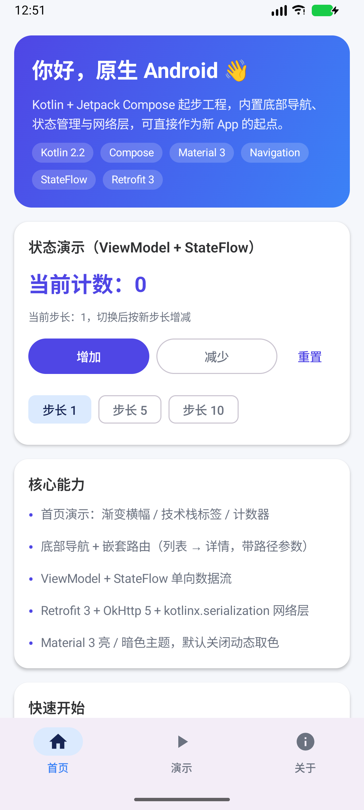

# Android 原生脚手架模板

开箱即用的 Android 原生起步模板（Kotlin 2.2 + Jetpack Compose + Material 3），单 Activity 架构，内置底部导航、嵌套路由、状态管理与网络层，首页演示与脚手架家族其他模板保持一致。



> 需要 Android Studio（当前工程用 Android Studio 2026.2 验证）+ JDK 17/21 + Android SDK Platform 37.2。

## 核心版本

| 依赖 | 版本 | 说明 |
| --- | --- | --- |
| Kotlin | 2.2 | AGP 9 内置 Kotlin 支持（Compose / 序列化编译器插件随版本目录对齐） |
| Android Gradle Plugin | 9.5.2 | 构建插件（要求 Gradle 9.6+，不再需要 kotlin-android 插件） |
| Gradle | 9.6.0 | 构建工具（Wrapper 已内置，华为云镜像 + SHA256 校验） |
| compileSdk | 37.2 | 编译 SDK（Android 17；Compose 1.13 要求 37.1+） |
| targetSdk | 37 | 目标系统版本 |
| minSdk | 26 | 最低 Android 8.0，直接使用自适应图标 |
| Jetpack Compose BOM | 2026.11.01 | Compose 依赖统一版本（Compose 1.13） |
| Material 3 | 1.5.0 | 设计规范与组件 |
| Navigation Compose | 2.10.2 | 页面导航（含嵌套路由） |
| Lifecycle / ViewModel | 2.11.1 | 生命周期与状态容器 |
| Retrofit | 3.0.0 | 网络请求 |
| OkHttp | 5.5.1 | 网络底座 + 日志拦截器 |
| kotlinx.serialization | 1.9.0 | JSON 序列化 |
| JUnit / Compose UI Test | 4.13.2 / BOM | 单元测试与界面测试 |

## 环境要求

- JDK 17 或 21（本机用 JDK 21 验证；Gradle 9.6 也支持更高版本）
- Android SDK Platform **37.2** + Build-Tools **37.0.0**（Android Studio SDK Manager 安装）
- Android Studio 打开工程后等待 Gradle 同步完成
- 运行需要 Android 8.0（API 26）及以上的真机或模拟器
- 注意：AGP 9 起 Kotlin 编译已内置，**不要**再添加 `org.jetbrains.kotlin.android` 插件（会直接报错）

## 快速开始

```bash
# 执行目录：android-scaffolding-template/
# 0. 安装缺失的 SDK（只需一次；也可用 Android Studio SDK Manager）
$ANDROID_HOME/cmdline-tools/latest/bin/sdkmanager "platforms;android-37.2" "build-tools;37.0.0"

# 1. 生成本机 SDK 路径配置（只需一次；Android Studio 打开时会自动生成）
echo "sdk.dir=$HOME/Library/Android/sdk" > local.properties

# 2. 构建 Debug APK
./gradlew assembleDebug

# 3. 安装到已连接的设备 / 模拟器
./gradlew installDebug

# 4. 启动应用（Debug 包名带 .debug 后缀）
adb shell am start -n com.androidscaffoldingtemplate.debug/com.androidscaffoldingtemplate.MainActivity
```

也可以直接用 Android Studio 打开本目录，等待同步后点击运行按钮（推荐，可自动选择设备 / 模拟器）。

## 常用命令

| 命令 | 说明 |
| --- | --- |
| `./gradlew assembleDebug` | 构建 Debug APK（输出 `app/build/outputs/apk/debug/`） |
| `./gradlew installDebug` | 安装 Debug 包到设备 |
| `./gradlew test` | 运行 JVM 单元测试（ViewModel 逻辑） |
| `./gradlew connectedDebugAndroidTest` | 运行仪器化 UI 测试（需设备） |
| `./gradlew lint` | 静态代码检查 |
| `./gradlew clean` | 清理构建产物 |

## 目录结构

```
├── settings.gradle.kts          # 仓库与模块声明
├── build.gradle.kts             # 根构建脚本（插件版本）
├── gradle.properties            # 构建参数 + API_BASE_URL 配置
├── gradle/
│   ├── libs.versions.toml       # 依赖版本目录（统一管理版本）
│   └── wrapper/                 # Gradle Wrapper（9.6.0，华为云镜像）
├── gradlew / gradlew.bat        # 跨平台构建入口
├── docs/images/                 # 界面截图（README 引用）
└── app/
    ├── build.gradle.kts         # 应用模块配置（包名 / 版本 / 依赖）
    ├── proguard-rules.pro       # Release 混淆规则
    └── src/
        ├── main/
        │   ├── AndroidManifest.xml
        │   ├── java/com/androidscaffoldingtemplate/
        │   │   ├── MainActivity.kt              # 入口 Activity（单 Activity）
        │   │   ├── data/
        │   │   │   ├── DemoRepository.kt        # 演示数据仓库（可换真实接口）
        │   │   │   └── model/NodeItem.kt        # 节点 / 分页模型
        │   │   ├── network/
        │   │   │   ├── ApiClient.kt             # OkHttp + Retrofit 单例
        │   │   │   ├── ApiService.kt            # 接口定义
        │   │   │   └── UserDto.kt               # 示例数据模型
        │   │   └── ui/
        │   │       ├── components/              # 通用组件（横幅 / 卡片 / 信息行）
        │   │       ├── navigation/              # 路由定义 + 根组件
        │   │       ├── screens/                 # 首页 / 演示 / 详情 / 关于
        │   │       ├── theme/                   # 配色 / 主题 / 字体
        │   │       └── viewmodel/DemoViewModel.kt # 页面状态与业务逻辑
        │   └── res/                              # 图标 / 字符串 / 主题资源
        ├── test/                                 # JVM 单元测试
        └── androidTest/                          # Compose UI 测试
```

## 基本引入的东西

- **UI**：Jetpack Compose + Material 3（渐变横幅 / 卡片 / FilterChip / 底部导航）
- **导航**：Navigation Compose，一级页面 + 详情嵌套路由（路径参数 `itemId`）
- **状态**：ViewModel + StateFlow，单向数据流，页面销毁自动取消协程
- **网络**：Retrofit 3 + OkHttp 5 + kotlinx.serialization，Debug 包自动打印请求日志
- **Kotlin 编译**：AGP 9 内置 Kotlin（无需独立 kotlin-android 插件），Compose / 序列化编译器插件按同版本接入
- **测试**：JVM 单元测试（协程虚拟时间）+ Compose UI 测试
- **工程化**：Version Catalog 统一版本、Gradle Wrapper 锁定构建环境、ProGuard 规则

## 演示功能说明

- **首页**：欢迎横幅 + 技术栈标签 + 计数器（步长 1 / 5 / 10、增加 / 减少 / 重置）
- **演示页**：
  - 路由节点分页（共 42 条 / 每页 6 条，边界自动禁用按钮）
  - 点击节点进入详情页（嵌套路由 + 路径参数 + 返回）
  - 网络请求状态演示（加载中 / 成功 / 失败三种状态）
- **关于页**：版本信息 / 技术栈 / 改造指引

## 作为起步模板使用

1. 复制本目录到新项目，用 Android Studio 打开并等待 Gradle 同步
2. 改包名：全局替换 `com.androidscaffoldingtemplate`（Android Studio 可用 Refactor → Rename）
3. 改应用名：`app/src/main/res/values/strings.xml` 的 `app_name`
4. 改接口地址：`gradle.properties` 的 `API_BASE_URL`（或构建时 `-PAPI_BASE_URL=...`）
5. 新增页面：在 `ui/screens` 新建 Compose 页面，在 `AppDestination` 与 `ScaffoldApp` 注册路由
6. 接入后端：用 `network/ApiClient.services` 调用真实接口，替换 `DemoRepository` 的模拟数据
7. 删除演示内容（首页卡片 / 演示页 / 关于页），保留主题、导航、网络层即可开始业务开发

## 常用配置

| 配置项 | 文件 | 说明 |
| --- | --- | --- |
| 应用名 / 图标 | `res/values/strings.xml` / `res/mipmap-anydpi-v26/` | 显示名称与自适应图标 |
| 包名 | `app/build.gradle.kts` | `namespace` + `applicationId` |
| 接口地址 | `gradle.properties` | `API_BASE_URL`，注入 `BuildConfig.API_BASE_URL` |
| 依赖版本 | `gradle/libs.versions.toml` | 统一升级入口 |
| 编译 / 目标版本 | `app/build.gradle.kts` | `compileSdk = 37` + `compileSdkMinor = 2` / `targetSdk` / `minSdk` |
| Kotlin 支持 | `app/build.gradle.kts` | AGP 9 内置，勿添加 `org.jetbrains.kotlin.android` |
| Gradle 版本 / 镜像 | `gradle/wrapper/gradle-wrapper.properties` | `distributionUrl` + 官方 SHA256 校验 |
| 签名配置 | `app/build.gradle.kts` | Release 默认未签名，发布前添加 signingConfigs |
| 混淆 | `app/proguard-rules.pro` | Release 开启 minify 后生效 |
| Gradle 内存 | `gradle.properties` | `org.gradle.jvmargs` |

## 常见问题

| 现象 | 原因与处理 |
| --- | --- |
| 启动时报 `Minimum supported Gradle version is 9.6.0` | AGP 9.5.2 要求 Gradle 9.6+：请用 `./gradlew`（Wrapper 已锁定），不要用本机安装的旧 Gradle |
| 下载 Gradle 发行包很慢 / 官方源超时 | Wrapper 默认走华为云镜像（带官方 SHA256 校验）；海外网络可换回官方地址（见 Wrapper 文件注释） |
| 报依赖要求 `compile against version 37.1 or later` | 安装 `platforms;android-37.2`，并保持 `compileSdk = 37` + `compileSdkMinor = 2` |
| 报 `The 'org.jetbrains.kotlin.android' plugin is no longer required` | AGP 9 已内置 Kotlin：删除该插件，只保留 Compose / 序列化插件 |
| Release APK 未签名无法安装 | 在 `app/build.gradle.kts` 配置 `signingConfigs` 后执行 `assembleRelease` |
| 首次构建需下载大量依赖 | 属正常现象，后续增量构建会自动使用缓存 |
