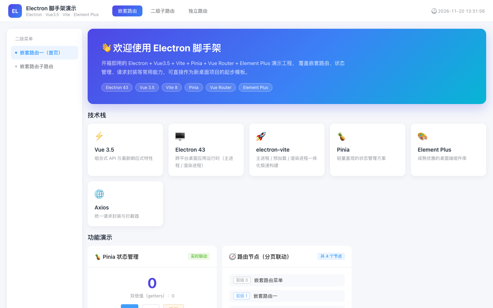

# Electron 脚手架模板



开箱即用的 Electron 桌面端起步模板（与 [vue3-scaffolding-template](../vue3-scaffolding-template) 风格功能保持一致，首页完全同款），基于 electron-vite 三进程结构（主进程 / 预加载 / 渲染进程），渲染层覆盖嵌套路由、状态管理、请求封装等常用能力，可直接作为新桌面项目的起步脚手架。

## 核心版本

| 依赖 | 版本 | 说明 |
| --- | --- | --- |
| electron | 43.8.12 | 桌面应用运行时（43.x 为兼容 macOS 12 的最高版本，macOS 13+ 可升级 45+） |
| electron-vite | 6.0.0 | 主进程 / 预加载 / 渲染进程一体化极速构建 |
| electron-builder | 26.18.0 | 应用打包分发（dmg / nsis / AppImage） |
| vue | 3.5.45 | 核心框架（组合式 API） |
| vue-router | 5.5.1 | 官方路由（Hash 模式，适配 file:// 加载） |
| pinia | 4.1.0 | 轻量状态管理 |
| element-plus | 2.14.8 | 桌面端组件库（中文语言包） |
| axios | 1.21.1 | HTTP 请求（统一封装 + 拦截器） |
| vite | 8.3.8 | 渲染进程构建工具 |
| @vitejs/plugin-vue | 6.0.11 | Vue 单文件组件编译插件 |
| @vitejs/plugin-vue-jsx | 5.1.6 | JSX 语法支持 |
| less | 4.9.1 | Less 样式预处理 |
| unplugin-auto-import | 21.1.0 | API 按需自动导入 |
| unplugin-vue-components | 32.1.0 | 组件（Element Plus）按需自动导入 |

## 环境要求

- Node.js >= 16（推荐 18 / 20 / 22）
- 包管理器推荐 [pnpm](https://pnpm.io/)（项目自带 pnpm-workspace.yaml）
- 操作系统：macOS 12+ / Windows 10+ / Linux（Electron 44 起要求 macOS 13+，如系统较新可自行升级 electron 版本）
- 国内网络：Electron 二进制与打包工具已内置 npmmirror 镜像（见 package.json 的 `config` 字段），开箱即用

## 快速开始

```bash
# 1. 安装依赖（执行目录：项目根目录）
pnpm install

# 2. 启动开发模式（渲染进程热更新 + 自动打开 Electron 窗口）
pnpm run dev

# 3. 构建并预览生产产物（可选）
pnpm run build
pnpm start
```

## 常用命令

| 命令 | 说明 |
| --- | --- |
| `pnpm run dev` | 启动开发模式（electron-vite dev，端口 5005） |
| `pnpm run build` | 构建三进程产物（输出到 out/） |
| `pnpm start` | 预览构建产物（electron-vite preview） |
| `pnpm run build:mac` | 打包 macOS 安装包（产物输出到 release/） |
| `pnpm run build:win` | 打包 Windows 安装包（nsis） |
| `pnpm run build:linux` | 打包 Linux 安装包（AppImage / deb） |

## 目录结构

```
├── index.html                 # 渲染进程入口 HTML
├── electron.vite.config.mjs   # electron-vite 配置（main / preload / renderer 三段式）
├── electron/
│   ├── main.js                # 主进程入口（窗口创建、应用生命周期）
│   └── preload.js             # 预加载脚本（contextBridge 安全桥接）
├── out/                       # 三进程构建产物（build 后生成：out/main、out/preload、out/renderer）
├── release/                   # 安装包产物（build:mac / win / linux 后生成）
├── docs/                      # 文档与截图
└── src/                       # 渲染进程（Vue3，结构与 vue3 脚手架完全一致）
    ├── main.js                # 应用入口（挂载路由、状态管理）
    ├── App.vue                # 根组件（Element Plus 中文语言包）
    ├── api/                   # 接口定义
    ├── router/index.js        # 路由配置（Hash 模式 + 动态浏览器标题）
    ├── store/                 # Pinia 仓库
    │   ├── index.js           # Pinia 实例
    │   ├── routes.js          # 路由表仓库
    │   └── demo.js            # 计数器演示仓库（state/getters/actions 范例）
    ├── utils/request.js       # Axios 实例与拦截器（统一错误提示）
    ├── views/                 # 页面组件
    │   ├── layout.vue         # 顶部导航布局（品牌 + 菜单 + 实时时钟）
    │   ├── template-layer.vue # 二级菜单侧边栏（嵌套路由容器）
    │   ├── template.vue       # 首页（欢迎横幅 + 技术栈 + 功能演示）
    │   ├── template2.vue      # 独立路由页（Axios 请求演示）
    │   └── template-child.vue # 嵌套路由子路由页
    ├── style.css              # 全局样式（CSS 变量 / 浅色主题）
    └── style.less             # 全局 Less 样式入口
```

## 基本引入的东西（内置封装）

| 能力 | 位置 | 引入方式 |
| --- | --- | --- |
| Electron 主进程 | electron/main.js | 窗口创建 + 生命周期（Node 环境，CJS） |
| 预加载安全桥接 | electron/preload.js | 渲染进程直接使用 `window.electronAPI`（示例：版本信息） |
| Vue 3 组合式 API | vue | `import { ref, onMounted } from 'vue'` |
| 路由（Hash） | src/router/index.js | `import router from '@/router'`（main.js 已挂载） |
| Pinia 状态管理 | src/store/demo.js | `import { useDemoStore } from '@/store/demo'` |
| 请求封装（拦截器） | src/utils/request.js | `import request from '@/utils/request'` |
| 接口定义 | src/api/ | `import { getSecurityUser } from '@/api'` |
| Element Plus | 全局按需自动引入 | 模板中直接写 `<el-button>` `<el-card>`，无需手动 import |
| 环境变量 | .env.development / .env.production | `import.meta.env.VITE_TINTMCE_BASE_URL` |

主进程 ↔ 渲染进程通信示例（已在模板中打通）：

```js
// 渲染进程（任意组件中）：读取预加载脚本暴露的运行时版本
const versions = window.electronAPI?.getVersions();

// 需要新增 IPC 时：electron/preload.js 用 contextBridge 暴露方法，
// electron/main.js 用 ipcMain.handle 注册处理函数（保持 contextIsolation 开启）
```

请求封装用法示例：

```js
// 接口层统一封装见 src/api/user.js
import { getSecurityUser } from '@/api';
const res = await getSecurityUser();
```

## 演示功能说明

- **嵌套路由**：顶部导航 + 二级侧边菜单，菜单与路由精确联动高亮（Hash 模式）
- **Pinia 状态管理**：首页计数器演示 state / getters / actions 标准写法
- **路由节点分页**：首页展示路由表节点，分页器与列表真实联动
- **Axios 请求封装**：独立路由页手动触发请求，展示 loading 与结果（拦截器见 `src/utils/request.js`）
- **实时时钟**：顶部栏每秒刷新，演示定时器的创建与卸载清理
- **进程安全桥接**：预加载脚本通过 contextBridge 暴露 `window.electronAPI`（上下文隔离开启）

## 作为起步模板使用

1. **获取模板**：clone 或复制本项目到本地
2. **安装依赖**：`pnpm install`（自动放行 electron 等构建脚本，二进制走 npmmirror 镜像）
3. **新增页面**：在 `src/views/` 新建 `.vue` 文件，再到 `src/router/index.js` 添加路由
   - `meta.name`：路由名称（展示在首页节点列表与窗口标题）
   - `meta.level`：层级（用于菜单分级展示）
   - `meta.node`：是否为叶子节点（首页节点列表筛选标记）
4. **新增菜单**：顶部导航改 `src/views/layout.vue` 的 `navList`，二级菜单改 `src/views/template-layer.vue` 的 `menuList`
5. **新增接口**：在 `src/api/` 中定义函数，统一使用 `@/utils/request` 实例发起请求
6. **新增状态**：仿照 `src/store/demo.js` 用 `defineStore` 定义仓库
7. **个性化**：品牌名与导航改 `layout.vue`；主题色改 `src/style.css` 的 CSS 变量；窗口尺寸与菜单改 `electron/main.js`
8. **构建发布**：`pnpm run build:mac` / `build:win` / `build:linux`，产物在 `release/`

## 常用配置

| 配置项 | 位置 | 说明 |
| --- | --- | --- |
| 路径别名 `@` | electron.vite.config.mjs | 指向 src 目录 |
| 开发端口 5005 | electron.vite.config.mjs（renderer.server.port） | 可按需修改 |
| 请求 baseURL | `.env` 中 `VITE_TINTMCE_BASE_URL` | 注入 `src/utils/request.js` |
| 窗口尺寸 / 菜单栏 | electron/main.js（BrowserWindow） | 宽高、最小尺寸、autoHideMenuBar 等 |
| 打包配置 | package.json（build 字段） | appId / productName / 目标平台 / 输出目录 |
| Electron 二进制镜像 | package.json（config.electron_mirror） | Electron 运行时下载走 npmmirror，海外可删除 |
| 打包工具镜像 | package.json（config.electron_builder_binaries_mirror） | dmgbuild 等 electron-builder 工具下载走 npmmirror |
| 渲染进程构建入口 | electron.vite.config.mjs（renderer.build.rolldownOptions.input） | 默认项目根 index.html |

> 镜像配置为什么在 package.json 的 `config` 字段：pnpm 12 不会把 `.npmrc` 自定义配置注入为 `npm_config_*` 环境变量，而 `npm_package_config_*` 会被注入到 `pnpm install` / `pnpm run` 全流程，正是 @electron/get 与 electron-builder 读取镜像的变量（`.npmrc` 中保留同值两行供 npm 用户使用）。

## 常见问题

- **macOS 启动报 `dyld: Symbol not found: (_OBJC_CLASS_$_SMAppService)`**：Electron 44+ 需要 macOS 13+ 运行时；本模板已固定 `electron@^43.8.12`（兼容 macOS 12+）。系统为 macOS 13+ 时可直接 `pnpm add -D electron@latest` 升级
- **打包 mac 报 `connect ECONNREFUSED 127.0.0.1:443`**：GitHub release 资产域名 `release-assets.githubusercontent.com` 被 DNS 污染到 `127.0.0.1`（`dig release-assets.githubusercontent.com` 可验证），dmg 打包所需的 dmgbuild 工具下载失败。本模板已内置 npmmirror 镜像配置（package.json `config` 字段），无需额外处理；若仍失败请检查是否被代理软件覆盖 DNS 并清理后重试
- **打包提示无法下载 electron-builder 依赖**：确认网络可访问 npmmirror；海外网络可删除 package.json `config` 中的镜像配置走 GitHub 官方源
- **打包提示 `skipped macOS application code signing`**：本机无「Developer ID Application」证书时跳过签名（正常现象）。未签名应用在其他 Mac 上首次打开需右键 → 打开，或执行 `xattr -cr /Applications/xxx.app` 清除隔离属性；正式分发请配置苹果开发者证书
