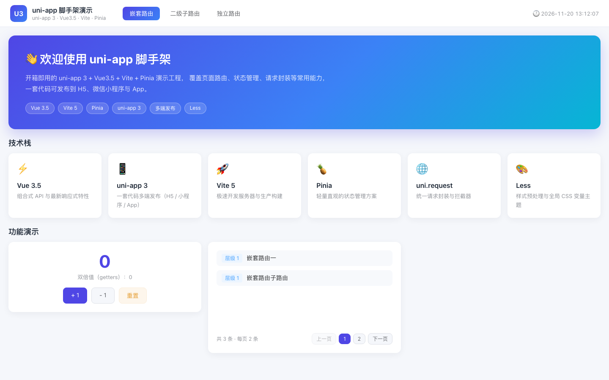

# uni-app 脚手架模板（Vue3）



开箱即用的 uni-app Vue3 多端起步模板（与 [vue3-scaffolding-template](../vue3-scaffolding-template) 风格功能保持一致），覆盖页面路由、状态管理、请求封装等常用能力，一套代码可发布到 H5、微信小程序与 App，可直接作为新项目的起步脚手架。

## 核心版本

| 依赖 | 版本 | 说明 |
| --- | --- | --- |
| @dcloudio/uni-app（uni-h5 / uni-mp-weixin 等全套） | 3.0.0-alpha-5030720261117001 | uni-app 3 多端框架（vue3 线最新构建） |
| @dcloudio/vite-plugin-uni | 3.0.0-alpha-5030720261117001 | uni-app 多端编译插件 |
| vue | 3.5.45 | 核心框架（组合式 API） |
| pinia | 4.1.0 | 轻量状态管理 |
| vite | 5.2.8 | 构建工具（uni-app 插件指定配套版本） |
| less | 4.9.1 | Less 样式预处理 |
| vue-i18n | 9.14.4 | uni-app 内置组件国际化支持 |
| @dcloudio/types | 3.4.32 | uni API 类型提示（IDE 智能提示用） |
| typescript | 5.9.3 | TS 支持（可选，按需使用） |

## 环境要求

- Node.js >= 16（推荐 18 / 20 / 22）
- 包管理器推荐 [pnpm](https://pnpm.io/)（项目自带 pnpm-workspace.yaml）
- 微信小程序端预览需安装「微信开发者工具」；App 端打包请参考 uni-app 官方文档（HBuilderX 云打包 / 本地离线打包）

## 快速开始

```bash
# 1. 安装依赖（执行目录：项目根目录）
pnpm install

# 2. 启动 H5 开发服务（默认端口 5005）
pnpm run dev:h5

# 3. 浏览器访问（Hash 路由）
# http://localhost:5005/#/pages/index/index
```

微信小程序端开发：

```bash
# 编译到 dist/dev/mp-weixin，再用微信开发者工具导入该目录
pnpm run dev:mp-weixin
```

## 常用命令

| 命令 | 说明 |
| --- | --- |
| `pnpm run dev:h5` | 启动 H5 开发服务（热更新，端口 5005） |
| `pnpm run dev:mp-weixin` | 微信小程序开发编译（产物在 dist/dev/mp-weixin） |
| `pnpm run dev:app` | App 开发编译 |
| `pnpm run build:h5` | H5 生产构建（产物输出到 dist/build/h5） |
| `pnpm run build:mp-weixin` | 微信小程序生产构建（产物输出到 dist/build/mp-weixin） |
| `pnpm run build:app` | App 生产构建 |

## 目录结构

```
├── index.html                 # H5 入口 HTML（小程序 / App 端由各自容器加载）
├── vite.config.js             # Vite 配置（uni 插件、@ 别名、开发端口）
├── .npmrc                     # pnpm 依赖安装配置（扁平化 node_modules）
├── pnpm-workspace.yaml        # pnpm 12 构建脚本放行配置
├── docs/                      # 文档与截图
└── src/
    ├── main.js                # 应用入口（createSSRApp + 挂载 Pinia）
    ├── App.vue                # 根组件（应用级生命周期）
    ├── manifest.json          # 应用配置（appid / 版本 / 各端设置）
    ├── pages.json             # 页面路由配置（页面注册 + 窗口样式 + easycom）
    ├── uni.scss               # 全局 SCSS 变量（uni 编译器自动注入）
    ├── api/                   # 接口定义
    │   ├── index.js           # 接口统一出口
    │   └── user.js            # 示例接口
    ├── components/            # 公共组件（easycom 自动引入，无需手动 import）
    │   ├── top-nav/top-nav.vue    # 顶部导航（品牌 + 菜单 + 实时时钟）
    │   └── page-card/page-card.vue # 通用卡片容器（还原 el-card 视觉）
    ├── pages/                 # 页面组件（与 pages.json 注册表一一对应）
    │   ├── index/index.vue    # 首页（欢迎横幅 + 技术栈 + 功能演示）
    │   ├── child/child.vue    # 子页面（页面跳转演示）
    │   └── request/request.vue # 独立路由页（请求封装演示）
    ├── store/                 # Pinia 仓库
    │   ├── index.js           # Pinia 实例
    │   ├── demo.js            # 计数器演示仓库（state/getters/actions 范例）
    │   └── pages.js           # 页面元信息树（meta 字段与 vue3 脚手架一致）
    ├── utils/request.js       # uni.request 统一封装（拦截器 + 统一错误提示）
    ├── static/                # 静态资源（图片等）
    └── style.css              # 全局样式（CSS 变量 / 浅色主题，与 vue3 脚手架同值）
```

## 基本引入的东西（内置封装）

| 能力 | 位置 | 引入方式 |
| --- | --- | --- |
| Vue 3 组合式 API | vue | `import { ref, computed } from 'vue'` |
| Pinia 状态管理 | src/store/demo.js | `import { useDemoStore } from '@/store/demo'` |
| 请求封装（拦截器） | src/utils/request.js | `import request from '@/utils/request'` |
| 接口定义 | src/api/ | `import { getSecurityUser } from '@/api'` |
| 公共组件 | src/components/ | easycom 自动引入：模板中直接写 `<top-nav>` `<page-card>` |
| 全局主题 | src/style.css | main.js 已引入，CSS 变量全局可用 |
| 环境变量 | .env.development / .env.production | `import.meta.env.VITE_TINTMCE_BASE_URL` |

请求封装用法示例：

```js
// 快捷方法
import request from '@/utils/request';
const res = await request.post('/role/getSecurityUser', { id: 1 });

// 或完整参数（接口层统一封装见 src/api/user.js）
const res = await request({ url: '/role/getSecurityUser', method: 'POST', data: {} });
```

Pinia 仓库用法示例：

```js
import { useDemoStore } from '@/store/demo';
const demoStore = useDemoStore();
demoStore.increment();          // action
console.log(demoStore.count);   // state
console.log(demoStore.doubleCount); // getter
```

## 演示功能说明

- **Pinia 状态管理**：首页计数器演示 state / getters / actions 标准写法
- **路由节点分页**：首页展示 pages.json 页面元信息节点，分页器与列表真实联动
- **请求封装**：独立路由页手动触发请求，展示 loading 与结果（拦截器见 `src/utils/request.js`）
- **实时时钟**：顶部导航每秒刷新，演示定时器的创建与卸载清理

## 作为起步模板使用

1. **获取模板**：clone 或复制本项目到本地
2. **安装依赖**：`pnpm install`
3. **新增页面**：在 `src/pages/` 新建页面目录与 `.vue` 文件，再到 `src/pages.json` 注册
   - 页面元信息（level / name / node）同步维护到 `src/store/pages.js`（首页节点列表数据源）
   - 页面默认隐藏原生导航栏（`navigationStyle: custom`），由 `top-nav` 自绘顶栏
4. **新增导航**：顶部导航改 `src/components/top-nav/top-nav.vue` 的 `navList`
5. **新增接口**：在 `src/api/` 中定义函数，统一使用 `@/utils/request` 实例发起请求
6. **新增状态**：仿照 `src/store/demo.js` 用 `defineStore` 定义仓库
7. **个性化**：品牌名与导航改 `top-nav.vue`；主题色改 `src/style.css` 的 CSS 变量；应用名与 appid 改 `src/manifest.json`
8. **构建发布**：`pnpm run build:h5`（静态服务器部署）/ `pnpm run build:mp-weixin`（微信开发者工具上传）

## 常用配置

| 配置项 | 位置 | 说明 |
| --- | --- | --- |
| 路径别名 `@` | vite.config.js | 指向 src 目录 |
| 开发端口 5005 | vite.config.js（server.port） | 可按需修改 |
| 请求 baseURL | `.env` 中 `VITE_TINTMCE_BASE_URL` | 注入 `src/utils/request.js` |
| 页面路由表 | src/pages.json | 页面注册、窗口样式、easycom 规则 |
| 应用配置 | src/manifest.json | 应用名 / appid / 版本 / 各端设置 |
| 微信小程序 appid | src/manifest.json（mp-weixin.appid） | 小程序发布必需 |
| 扁平化依赖安装 | .npmrc（node-linker=hoisted） | uni 编译器解析 pinia 等传递依赖所需，勿删 |

## 与 vue3-scaffolding-template 的差异

- **页面路由**：uni-app 没有 vue-router，使用 `pages.json` 注册页面 + `uni.navigateTo` / `uni.reLaunch` / `uni.navigateBack` 跳转（顶部主导航切换用 `reLaunch` 重置页面栈，效果等同路由切换）
- **UI 组件**：Element Plus 仅支持 H5 端，为保证多端一致，卡片 / 按钮 / 分页器等由内置组件 + 自绘样式还原同款视觉
- **请求封装**：基于 `uni.request`（axios 无法运行于小程序 / App 端），拦截器写法与 vue3 脚手架保持一致
- **依赖安装**：`.npmrc` 固定 `node-linker=hoisted`（扁平化 node_modules），解决 uni 编译器对 pinia 4 传递依赖的解析问题
